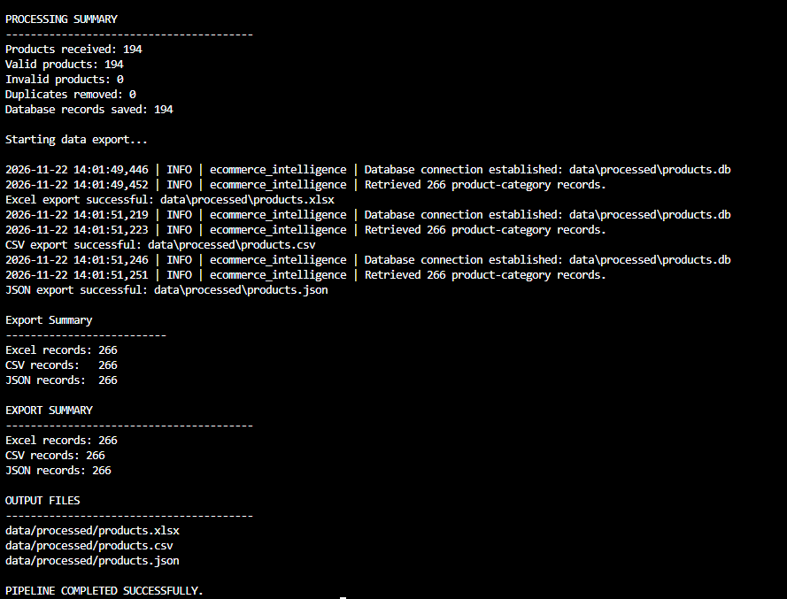
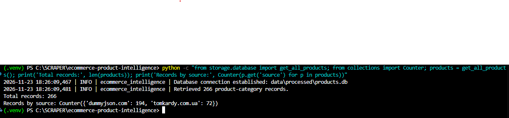
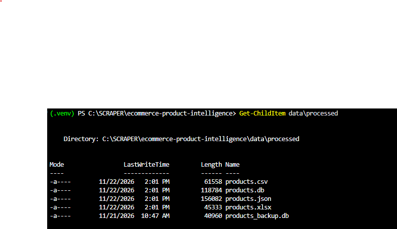
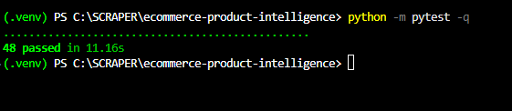

# E-Commerce Product Intelligence System

A Python-based e-commerce data extraction and intelligence application designed to collect, normalize, validate, store and export structured product information from multiple data sources.

The application supports HTML-based product extraction and REST API integration, with automated data processing, duplicate detection, SQLite database storage and multi-format exports.

## 1. Project Overview

E-commerce businesses work with large volumes of product information distributed across websites and APIs.

Collecting, organizing and preparing this information manually can be time-consuming.

This project implements an automated data acquisition and processing pipeline that transforms product information into structured datasets suitable for reporting, analysis and further integration.

The system demonstrates:

- HTML product extraction.
- REST API integration.
- API pagination.
- Data cleaning and normalization.
- Data validation.
- Duplicate detection.
- Multi-source database management.
- Automated Excel, CSV and JSON exports.
- Automated software testing.

The application has been demonstrated using locally stored HTML fixtures and the DummyJSON demonstration product API.

## 2. Key Features

### Data Acquisition
- HTTP communication using Python Requests.
- Reusable HTML scraper architecture.
- HTML parsing using BeautifulSoup.
- Product information extraction.
- REST API integration.
- Configurable API request parameters.
- API pagination.
- Request timeouts and HTTP error handling.
- Robots.txt permission checking for HTML scraping.

### Data Processing
- Product data normalization.
- Data cleaning.
- Product validation.
- Duplicate detection.
- Invalid-record handling.
- Category-based product grouping.
- Multi-source data processing.

### Data Storage
- SQLite database integration.
- Structured product storage.
- Category associations.
- Source identification.
- Database schema migration.
- Configurable database paths.

### Data Export
- Excel export.
- CSV export.
- JSON export.
- Centralized export management.

### Software Quality
- Modular application architecture.
- Structured logging.
- Automated tests using Pytest.
- API client tests.
- Pipeline integration tests.

## 3. Technology Stack

| Technology | Purpose |
|---|---|
| Python | Core application development |
| Requests | HTTP communication and API integration |
| BeautifulSoup4 | HTML parsing |
| SQLite | Structured database storage |
| Pandas | Data processing |
| OpenPyXL | Excel file generation |
| Pytest | Automated testing |
| urllib.robotparser | Robots.txt evaluation |
| Logging | Application monitoring |

## 4. System Architecture

The application supports two data acquisition approaches.

### HTML Extraction Pipeline

```text
HTML Product Pages
        |
        v
   HTTP Requests
        |
        v
  BeautifulSoup Parser
        |
        v
  Product Extraction
        |
        v
   Data Cleaning
        |
        v
  Data Validation
        |
        v
 Duplicate Detection
        |
        v
  SQLite Database
```

### REST API Extraction Pipeline

```text
   DummyJSON API
         |
         v
    API Client
         |
         v
     Pagination
         |
         v
 Product Normalization
         |
         v
    Data Cleaning
         |
         v
   Data Validation
         |
         v
  Duplicate Detection
         |
         v
   SQLite Database
```

### Export Pipeline

```text
    SQLite Database
           |
           v
      Export Manager
           |
      +----+----+
      |    |    |
      v    v    v
    Excel CSV  JSON
```

## 5. Project Structure

```text
ecommerce-product-intelligence/
│
├── config/
│   ├── __init__.py
│   └── logging_config.py
│
├── data/
│   ├── raw/
│   │   └── HTML demonstration fixtures
│   │
│   └── processed/
│       ├── products.db
│       ├── products.xlsx
│       ├── products.csv
│       └── products.json
│
├── processors/
│   ├── __init__.py
│   ├── cleaning.py
│   ├── pipeline.py
│   ├── product_parser.py
│   └── validation.py
│
├── scrapers/
│   ├── __init__.py
│   ├── base_scraper.py
│   ├── pagination.py
│   ├── perfume_scraper.py
│   └── dummyjson_api.py
│
├── storage/
│   ├── data_exporter.py
│   ├── database.py
│   ├── excel_exporter.py
│   └── export_manager.py
│
├── tests/
│   ├── test_api_pipeline.py
│   ├── test_dummyjson_api.py
│   └── Other application test modules
│
├── .gitignore
├── api_main.py
├── check_robots.py
├── generate_test_fixtures.py
├── live_main.py
├── main.py
├── requirements.txt
└── README.md
```

## 6. Installation

### Prerequisites

- Python 3.11 or newer.
- Git.
- pip.

### Clone the repository

```bash
git clone https://github.com/mark123-eng/ecommerce-product-intelligence.git

cd ecommerce-product-intelligence
```

### Create a virtual environment

Windows:

```powershell
python -m venv .venv
```

Activate the environment:

```powershell
.venv\Scripts\Activate.ps1
```

### Install dependencies

```bash
python -m pip install -r requirements.txt
```

## 7. Running the Application

The project provides separate entry points for different execution workflows.

### A. API-Based Product Extraction

Execute:

```bash
python api_main.py
```

This workflow:

1. Connects to the DummyJSON product API.
2. Retrieves product records using paginated HTTP requests.
3. Normalizes API responses into the application's product schema.
4. Cleans and validates product records.
5. Detects duplicate products.
6. Stores valid records in SQLite.
7. Exports database records into Excel, CSV and JSON.

The API client uses the following endpoint:

```text
https://dummyjson.com/products
```

The demonstration API returned 194 product records during the verified execution.

### B. Offline HTML Processing

Execute:

```bash
python main.py
```

This workflow processes locally stored HTML fixtures.

It performs:

1. HTML fixture loading.
2. Product information extraction.
3. Data cleaning.
4. Product validation.
5. Duplicate detection.
6. SQLite storage.
7. Multi-format data export.

### C. HTML Live Extraction

The project also contains an HTML scraper entry point:

```bash
python live_main.py
```

Live extraction must only be performed against websites that authorize automated access.

The previously tested demonstration website returned HTTP 429 bot protection. Fresh live extraction from that website has therefore not been verified.

## 8. API Integration

The application includes a dedicated API client:

```text
scrapers/dummyjson_api.py
```

The client provides:

- HTTP GET requests.
- Configurable request timeouts.
- Pagination using limit and skip parameters.
- Response validation.
- Product normalization.
- Session management.

The API integration uses DummyJSON, a public demonstration API.

Its product records are sample data and should not be interpreted as verified commercial inventory.

**Currency handling:** The demonstration API does not provide a currency field. The application uses a configurable USD default for normalized records. This is an application assumption, not currency information supplied by the API.

## 9. Database Storage

The application uses SQLite.

Database location:

```text
data/processed/products.db
```

The database supports product records from different acquisition sources.

Each stored product can be associated with:

- Product identifier.
- Product name.
- Product category.
- Product code.
- Product URL.
- Price information.
- Currency.
- Discount information.
- Source website or API.

The database is designed to support multiple product data sources.

## 10. Data Export

The export manager coordinates the generation of three output formats.

Output directory:

```text
data/processed/
```

Generated files:

```text
products.xlsx
products.csv
products.json
```

### Excel

Provides a spreadsheet format suitable for business reporting and manual inspection.

### CSV

Provides a structured tabular format suitable for importing into data analysis applications.

### JSON

Provides a machine-readable format suitable for programmatic processing and system integration.

## 11. Automated Testing

The application uses Pytest for automated testing.

Run all tests:

```bash
python -m pytest -v
```

Run a concise report:

```bash
python -m pytest -q
```

### Verified Test Results

Latest verified test execution:

```text
48 passed in 4.87s
```

The tests cover existing scraper functionality, data processing, database operations, exports, API client functionality and API pipeline integration.

## 12. Demonstration Results

### API Extraction Results

During the latest successful API execution:

| Metric | Result |
|---|---:|
| Products retrieved | 194 |
| Valid products | 194 |
| Invalid products | 0 |
| Duplicates removed | 0 |
| Records saved | 194 |

### Combined Database Results

The database contained records from two sources:

| Source | Records |
|---|---:|
| DummyJSON API | 194 |
| Previously collected HTML data | 72 |
| **Total** | **266** |

### Export Results

| Export Format | Records |
|---|---:|
| Excel | 266 |
| CSV | 266 |
| JSON | 266 |

The 266 records represent the combined database, not 266 newly retrieved API products.

## 13. Responsible Data Collection

The application incorporates responsible data collection practices.

These include:

- Robots.txt permission checking.
- Configurable request delays.
- HTTP request timeouts.
- HTTP error handling.
- Explicit handling of rate-limit responses.
- Avoidance of unauthorized access restrictions.

Automated collection should only be performed against sources that permit the activity.

The DummyJSON integration uses a public demonstration API. Other commercial API integrations should follow their respective provider terms, access requirements and rate limits.

## 14. Future Development

Potential extensions include:

- Additional authorized e-commerce API integrations.
- Historical product price tracking.
- Product availability monitoring.
- Scheduled data collection.
- Product intelligence dashboards.
- REST API endpoints.
- Automated market reporting.
- Advanced product analytics.

## 15. Project Status

The core application has been implemented and successfully executed.

Completed capabilities include:

- HTML product extraction.
- REST API product extraction.
- API pagination.
- Data normalization and cleaning.
- Data validation.
- Duplicate detection.
- Multi-source SQLite storage.
- Excel, CSV and JSON exports.
- Automated testing.

The latest verified test suite contains 48 passing tests.

## 16. Author

Developed as a Python automation and data engineering portfolio project.

**Technologies:** Python | Web Scraping | REST APIs | Data Engineering | SQLite | Pandas | Automation | Pytest

## Application Screenshots

### 1. API Data Extraction


### 2. Database Verification


### 3. Data Export Outputs


### 4. Automated Testing
